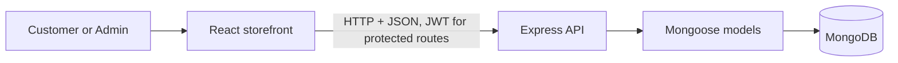
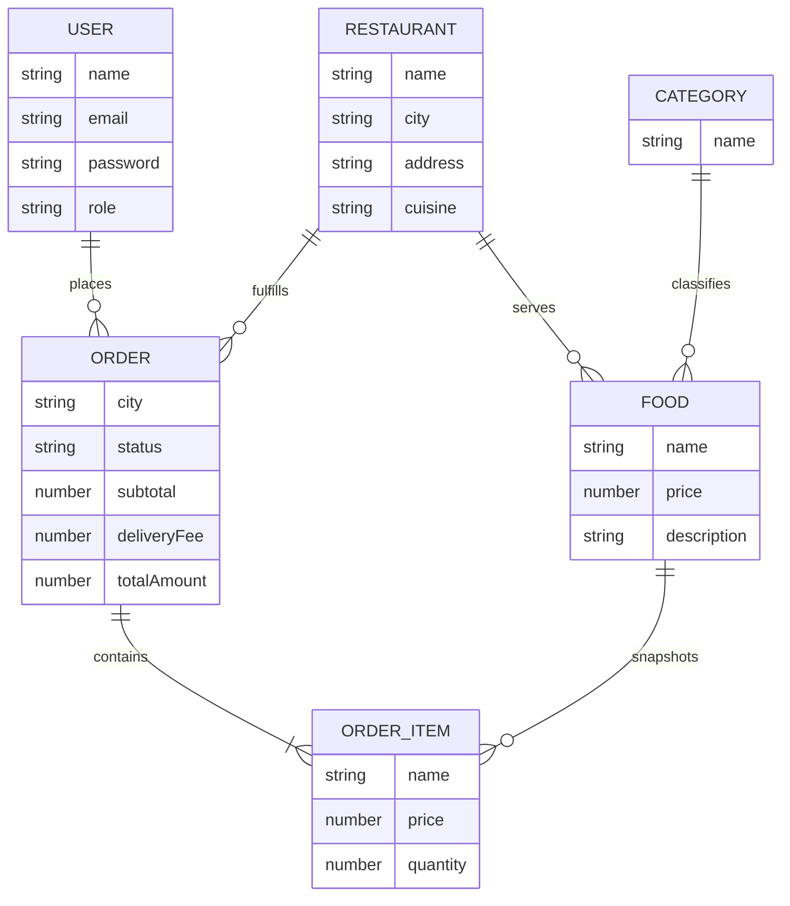

# FoodieGo — Project Guide

## Project summary

FoodieGo is a full-stack food ordering prototype for Chandigarh and Punjab. Customers can choose a city and neighborhood, discover matching restaurants and dishes, switch between saved light and dark themes, add dishes from one restaurant to a bag, place a Cash on Delivery order, and review their order history. Administrators can manage restaurants, dishes, categories, customers, and order statuses.

Restaurant names, menus, images, and ratings in this project are sample data for demonstration. They do not represent verified restaurants or live delivery coverage.

## Technology

| Layer | Technology | Responsibility |
| --- | --- | --- |
| Client | React, Vite, React Router | Responsive storefront and admin interface |
| API | Node.js, Express | Authentication, catalog, profile, and order endpoints |
| Database | MongoDB, Mongoose | Users, restaurants, categories, dishes, and orders |
| Authentication | JWT, bcryptjs | Signed sessions and hashed account passwords |

## Architecture

## Data model

Order items store a snapshot of the dish name and price at checkout so an order remains readable if the catalog changes later.
The `User.password` field stores a bcrypt hash and is excluded from normal query results.

## Local setup

Requirements: Node.js 18 or newer and a reachable MongoDB instance.

1. Install root and app dependencies with `npm install` and `npm run install:all`.
2. Copy `server/.env.example` to `server/.env`. Set `MONGO_URI` and replace `JWT_SECRET` with a long random development secret.
3. Optionally copy `client/.env.example` to `client/.env.local` when you need to override the frontend API URL.
4. Start MongoDB before starting the API.
5. For a fresh demo database, run `npm run seed`, then `npm run seed:punjab` and `npm run seed:chandigarh`. The first command resets the demo collections. The city seeders only add or update their own sample listings.
6. Start the client and API together with `npm run dev`.
7. Open `http://localhost:5173`. The API health endpoint is `http://localhost:5001/api/health` and reports database connection state.

Demo accounts are listed in the main README. Use them only with a local demo database. Never publish a real `.env` file or demo credentials as production secrets.

## Main API areas

- Authentication: register, login, and retrieve the current profile.
- Discovery: list restaurants and foods by city and neighborhood; filter foods by restaurant, category, search, and price order.
- Customer account: update profile and read only that account's orders.
- Ordering: validate menu item availability, IDs, and integer quantities on the server; enforce one restaurant per order; use current database prices; calculate delivery fees on the server; and save a status-tracked order.
- Administration: protected catalog management, availability controls, order status updates, user list, and database-backed business summary with popular dishes.

Protected API routes require an `Authorization: Bearer <token>` header. Administrator routes also check the authenticated user's role.

## Verification checklist

- `npm run build --prefix client` builds the production client bundle.
- `npm test` checks server order pricing, delivery thresholds, quantity validation, availability, and restaurant consistency.
- `GET /api/health` reports whether MongoDB is connected.
- City-scoped restaurant and food responses should be populated for the seven configured cities.
- Customer and administrator demo logins should work; admin endpoints should reject requests without an administrator token.
- A customer must sign in before placing an order. The checkout page explains this and preserves the locally stored bag while the customer signs in.

## Current scope and limitations

The payment option is Cash on Delivery; no payment gateway is configured. Tax and promotional discounts are not calculated because the project has no configured tax jurisdiction or discount policy. Delivery is ₹39 below ₹599. Images and fonts are loaded from external services. Restaurant, menu, and rating data are demo fixtures. Before public deployment, use production secrets and HTTPS, configure production CORS, add rate limiting and account recovery, and connect a real payment and image storage provider.
